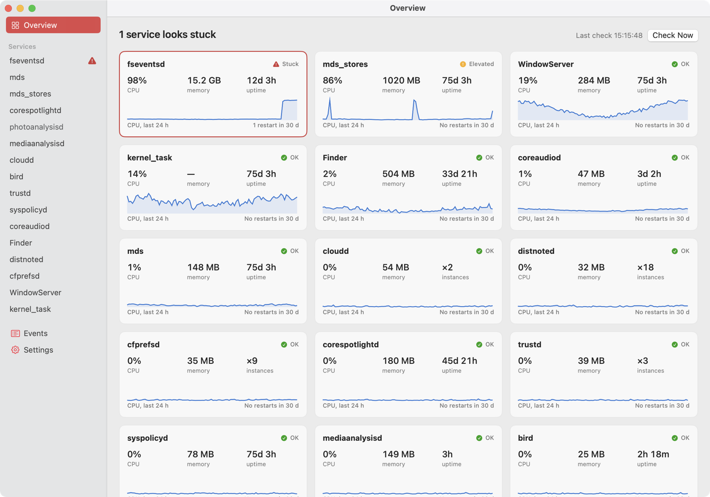
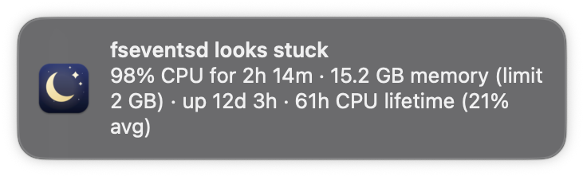
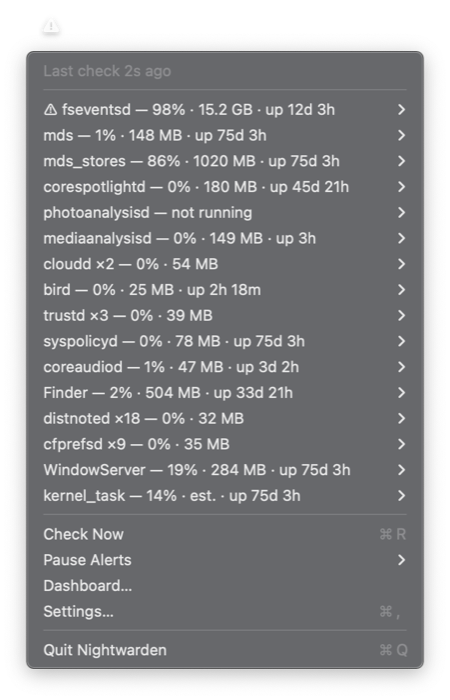
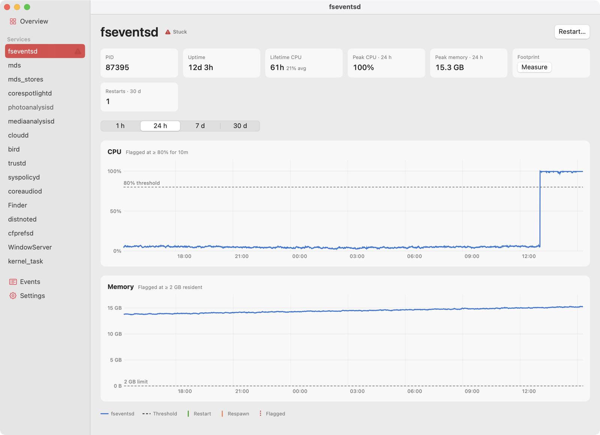
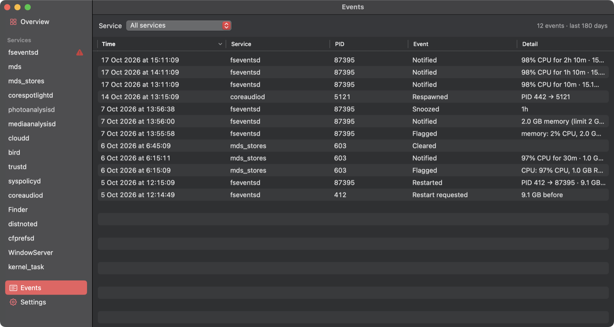
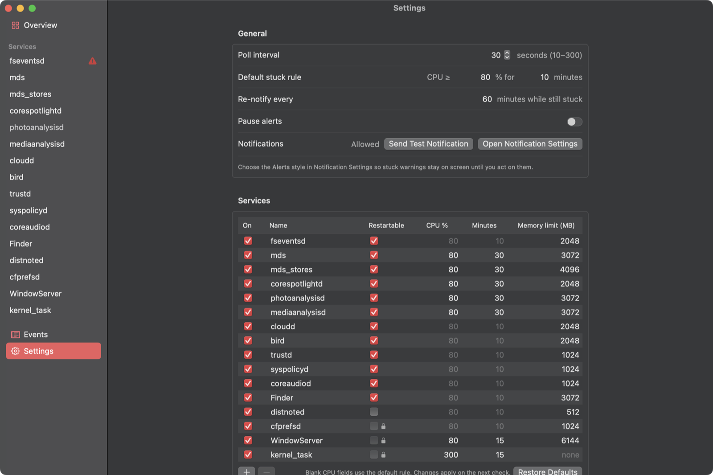

<div align="center">


# Nightwarden

**A tiny macOS menu-bar watchdog for stuck system daemons.**<br>
It notices when `fseventsd`, Spotlight, `cloudd` and friends get stuck. It restarts them only when you click.

[](https://github.com/aurimasniekis/swift-nightwarden/actions/workflows/ci.yml)
[](https://github.com/aurimasniekis/swift-nightwarden/releases)


[](LICENSE)

<picture>
  <source media="(prefers-color-scheme: dark)" srcset="docs/images/overview-dark.png">
  
</picture>

</div>

---

## Why

One day my Mac felt slow. `fseventsd`, the daemon behind file-change notifications, had been stuck for **75 days**. One thread was pinned at 100% CPU, and its memory footprint was **15.2 GB**. Running `killall fseventsd` fixed it at once: launchd respawned it at 3 MB.

macOS never tells you this has happened. Nightwarden does. It watches a short list of system services. When one stays pinned on CPU or grows past a sane memory limit, it sends a notification with a **Restart** button. It never kills anything on its own.

## Features

- **Lives in the menu bar.** A moon icon that turns into ⚠ while something is stuck, with live CPU, memory and uptime for every watched service.
- **Notifications you can act on.** For example: *"fseventsd looks stuck: 98% CPU for 2h 14m · 15.2 GB memory · up 12d 3h"*, with **Restart**, **Snooze 1h** and **Ignore this PID** buttons.
- **Click-only restarts.** Your own processes get `SIGTERM`, then `SIGKILL` if needed. System daemons go through the standard macOS administrator prompt. Nightwarden then waits for launchd to respawn the process and tells you how much memory came back.
- **Metrics history.** A dashboard with 24-hour sparklines, CPU and memory charts over 1 hour to 30 days, threshold lines, and markers for flags, restarts and crashes.
- **Rules for each service.** The default is ≥ 80% CPU for 10 minutes or more memory than a set limit. You can override it for any service in Settings.
- **Light on resources.** One `ps` call every 30 seconds. A SQLite history of a few MB. No network access, no telemetry, and no privileged helper.
- **Safe by design.** `WindowServer`, `kernel_task` and `cfprefsd` can never be restarted, and the PID is checked again right before any kill.

<table>
  <tr>
    <td width="50%"></td>
    <td width="50%" rowspan="2"></td>
  </tr>
  <tr>
    <td><sub>Notifications show how long a service has been stuck and how big it has grown. Hover over one for <b>Restart</b> / <b>Snooze 1h</b> / <b>Ignore this PID</b>.</sub></td>
  </tr>
</table>

## Install

### Download

1. Download the latest `Nightwarden-x.y.z.zip` from [**Releases**](https://github.com/aurimasniekis/swift-nightwarden/releases) and move `Nightwarden.app` to `/Applications`.
2. The app is ad-hoc signed, not notarized. On first launch, **right-click it → Open**, or clear the quarantine flag:
   ```sh
   xattr -dr com.apple.quarantine /Applications/Nightwarden.app
   ```
3. To start it at login, add it in **System Settings → General → Login Items**.

### Build from source

Building needs Xcode 16 or later (Swift 5.9+) on macOS 14 or later.

```sh
git clone https://github.com/aurimasniekis/swift-nightwarden.git
cd swift-nightwarden
make install
```

`make install` builds the app, copies it to `~/Applications`, and registers a LaunchAgent. The agent starts Nightwarden at login and relaunches it if it crashes. Choosing **Quit** keeps it quit.

### Turn on Alerts

Open **System Settings → Notifications → Nightwarden** and choose the **Alerts** style. Otherwise macOS shows banners that vanish after a few seconds, often before you can press Restart.

## How it works

| | |
|---|---|
| **Sampling** | Every 30 seconds (adjustable from 10 to 300), Nightwarden runs one `ps` and computes each watched process's CPU % from the change in its CPU time. Every PID is tracked on its own, so services with many instances, like `distnoted` or `trustd`, work too. |
| **Stuck rule** | A PID is flagged once its CPU stays at or above the threshold for the set time. Two samples in a row below the threshold reset the clock. A PID is also flagged when its resident memory is over the limit on two samples in a row. |
| **Alerts** | One notification per episode, repeated every 60 minutes while the service stays stuck. Snooze, Ignore and **Pause alerts** (1 h / 8 h / until resumed) quiet it down. |
| **Restart** | Nightwarden checks the PID still belongs to the same executable. Processes you own get `SIGTERM`, then `SIGKILL` after 3 s. Anything else runs through the macOS administrator prompt; only the numeric PID ever reaches the shell. Nightwarden then waits up to 15 s for launchd to start a new instance. |
| **Memory figure** | Notifications show the physical footprint from `top`, the same number Activity Monitor shows. They fall back to resident memory when `top` can't read it. |

### Watched by default

| Service | What it does | Restartable | Rule |
|---|---|:---:|---|
| `fseventsd` | File-system change events | ✓ | 80% / 10 min · 2 GB |
| `mds`, `mds_stores`, `corespotlightd` | Spotlight indexing | ✓ | 80% / 30 min · 3 / 4 / 2 GB |
| `photoanalysisd`, `mediaanalysisd` | Photos & media analysis | ✓ | 80% / 30 min · 3 GB |
| `cloudd`, `bird` | iCloud sync | ✓ | 80% / 10 min · 2 GB |
| `trustd`, `syspolicyd` | Certificates & Gatekeeper | ✓ | 80% / 10 min · 1 GB |
| `coreaudiod` | Audio | ✓ | 80% / 10 min · 1 GB |
| `Finder` | Finder | ✓ | 80% / 10 min · 3 GB |
| `distnoted`, `cfprefsd` | Notifications & preferences | — | 80% / 10 min · 512 MB / 1 GB |
| `WindowServer` | Everything you see | — | 80% / 15 min · 6 GB |
| `kernel_task` | The kernel | — | 300% / 15 min |

Add any other process by name in Settings.

## Dashboard

Open **Dashboard…** from the menu. Each service page charts CPU and memory with its thresholds, and marks every flag, restart and respawn. It also shows lifetime CPU, peak values for the selected range, the current footprint and the restart count.

<picture>
  <source media="(prefers-color-scheme: dark)" srcset="docs/images/detail-dark.png">
  
</picture>

<table>
  <tr>
    <td width="50%"></td>
    <td width="50%"></td>
  </tr>
  <tr>
    <td><sub><b>Events:</b> every flag, notification, snooze, restart and respawn, kept for 180 days.</sub></td>
    <td><sub><b>Settings:</b> poll interval, default rule, and a per-service table. Blank fields use the default.</sub></td>
  </tr>
</table>

<sub>Screenshots use demo data.</sub>

## Configuration & data

Everything is set in the app, and changes apply on the next check. Under the hood:

| | Location |
|---|---|
| Settings | `~/Library/Application Support/Nightwarden/config.json` |
| Metrics | `~/Library/Application Support/Nightwarden/metrics.sqlite` |

Metrics keep raw samples for 48 hours, 5-minute averages for 30 days and events for 180 days, which comes to a few MB. Nothing leaves your Mac.

For scripting and testing:

```sh
# Print what Nightwarden sees right now (two samples 3 s apart)
/Applications/Nightwarden.app/Contents/MacOS/Nightwarden --print

# Use a separate config (metrics go next to it)
NIGHTWARDEN_CONFIG=/tmp/nw/config.json /Applications/Nightwarden.app/Contents/MacOS/Nightwarden

# Open the dashboard on a given page at launch
/Applications/Nightwarden.app/Contents/MacOS/Nightwarden --show fseventsd
```

## FAQ

**Is it safe to restart these daemons?**
The restartable ones are run by launchd and come back within seconds. This is the same thing you'd do by hand with `killall fseventsd`. Nightwarden never restarts anything without your click, and it refuses `WindowServer`, `kernel_task` and `cfprefsd` outright.

**Why doesn't it restart things automatically?**
A daemon at 100% CPU is sometimes doing real work, for example Spotlight indexing after an update. Nightwarden tells you what it sees and leaves the decision to you.

**Why is `kernel_task` CPU marked as "estimated"?**
macOS only shows PID 0 to root. Nightwarden estimates it as total CPU in use minus the CPU used by every process it can see. Its memory isn't sampled.

**Why does the password prompt mention `osascript`?**
Root daemons are restarted with AppleScript's `do shell script … with administrator privileges`, run in a separate helper process so the app never freezes behind the dialog. The prompt's text says what Nightwarden is about to restart.

**How do I uninstall it?**
If you used `make install`, run `make uninstall`; it keeps your settings and history. `make purge` removes those too. Otherwise, quit the app, delete it, and delete `~/Library/Application Support/Nightwarden`.

## Development

```sh
make          # build build/Nightwarden.app (ad-hoc signed)
make test     # unit tests (swift-testing)
make run      # build and open
make dist     # zipped app + SHA-256, e.g. make dist VERSION=1.2.3
make icon     # re-render Resources/AppIcon.icns from Resources/AppIcon.swift
make clean
```

| Path | |
|---|---|
| `Sources/NightwardenCore` | Pure logic: `ps` parsing, CPU sampling, the stuck detector, config, SQLite metrics. Fully unit-tested. |
| `Sources/Nightwarden` | The AppKit + SwiftUI app: menu bar, notifications, restarts, dashboard. |
| `Tests/NightwardenCoreTests` | Parser, sampler, detector, metrics store and formatting tests. |
| `Resources` | `Info.plist`, LaunchAgent template, app icon. |

CI builds and tests every push and pull request. To release, push a tag such as `v1.2.3`; the release workflow builds the app and attaches the zip and its checksum to a GitHub release.

## License

[MIT](LICENSE) © 2026 Aurimas Niekis
